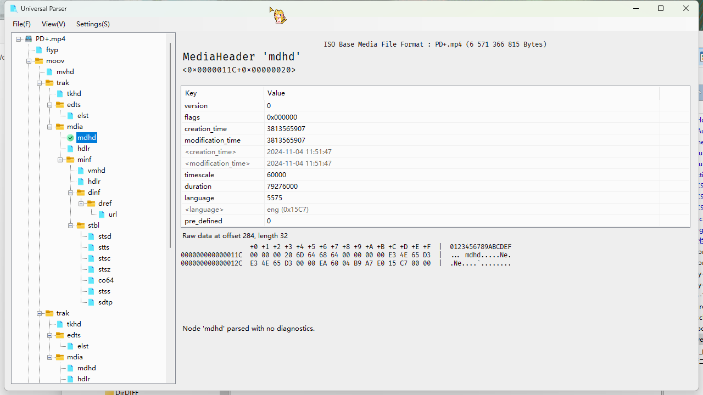

# UniversalParser

[](https://dotnet.microsoft.com/)
[](#系统要求)
[](#版本)
[](#构建与测试)
[](LICENSE)

只读的二进制结构解析工作台：把容器/分块型文件切成结构树，展示字段、Hex 与解析报告。
面向**故障分析**，不做解码、播放或修复。

*A read-only binary structure explorer for Windows: parse container/chunked files into a
tree, inspect fields and hex, and export a diagnostic report.*


<p align="center">
  
</p>


---

## 目录

- [特性](#特性)
- [支持的格式](#支持的格式)
- [系统要求](#系统要求)
- [快速开始](#快速开始)
- [配置](#配置)
- [构建与测试](#构建与测试)
- [项目结构](#项目结构)
- [设计原则](#设计原则)
- [已知限制与非目标](#已知限制与非目标)
- [文档](#文档)
- [版本](#版本)
- [许可证](#许可证)

---

## 特性

- **结构树浏览**：按官方规范切分容器/块，懒加载展开，字段列表虚拟化。
- **原始值优先**：先显示原始值与官方字段名，再给必要的人类可读解释。
- **64 位 Hex 视图**：按范围惰性读取，支持超大文件，不整块载入内存。
- **故障分析报告**：导出带偏移、字段与诊断的文本报告；Hex 固定首尾各 128 KiB。
- **诊断而非校验**：解析失败返回**部分结果 + 诊断**，不中断、不丢失已解析内容。
- **统计视图**：块数量、类型分布与大小汇总。
- **可配置读取上限**：`ParseLimits` 为唯一默认来源，可用 exe 旁的 JSON 局部覆盖。

## 支持的格式

| 类别 | 格式 |
|---|---|
| 容器/分块 | ISOBMFF、RIFF、EBML、FLV、ASF、Ogg、FLAC |
| 图像 | PNG / APNG、JPEG、PSD / PSB |
| 音频/媒体 | MIDI |
| 三维/资源 | FBX、Blender（无压缩） |
| 序列化 | Protocol Buffers、Minecraft NBT（无压缩） |
| 其他 | Raw（无结构回退） |
| 内嵌元数据 | EXIF、ID3v2、ICC、8BIM |

未知块不会猜测：一律显示为显式 `Unparsed` 节点并保留 raw 前缀。

## 系统要求

- Windows x64
- [.NET 10 Desktop Runtime (x64)](https://dotnet.microsoft.com/download/dotnet/10.0)

发布物为 **framework-dependent 单文件**，不包含运行时，需先安装上述运行时。
程序启用 `RollForward=LatestMajor`，安装更新主版本的 .NET 运行时时仍可启动。

## 快速开始

1. 从 [Releases](../../releases) 下载两个附件，放在同一目录：

   ```text
   UniversalParser_1.0.1.exe                 Windows x64，单文件，framework-dependent
   universalparser.limits.example.json       可选限制配置示例
   ```

2. 双击 `UniversalParser_1.0.1.exe` 启动。
3. 打开文件后，在左侧结构树中选择节点，右侧查看字段与 Hex。

## 配置

读取上限可通过 exe 同目录的 `universalparser.limits.json` 局部覆盖。把示例复制为正式文件名，
**只保留需要覆盖的键**：

```json
{
  "maxStringBytes": 4194304,
  "maxBlobBytes": 268435456,
  "maxDataLines": 10000
}
```

- 缺失的键使用内置默认值。
- JSON 损坏时回退默认值，并在状态栏提示。
- 探测窗口与长时间读取的 512 KiB 阈值固定，不可配置。
- 树深度、节点数、解析时长**不设限**。

## 构建与测试

需要 .NET SDK 10（`global.json` 锁定 `10.0.202`，允许前滚到更新的特性带）。

```powershell
dotnet build UniversalParser.sln
dotnet test UniversalParser.sln
dotnet format UniversalParser.sln --verify-no-changes
```

当前状态：`dotnet build` 0 warning / 0 error（含 `AnalysisLevel=latest-all`），
`dotnet test` **170 passed**。

发布：

```powershell
dotnet publish src/UniversalParser.App/UniversalParser.App.csproj `
  -c Release -r win-x64 -p:SelfContained=false `
  -p:PublishSingleFile=true `
  -p:DebugType=None -p:DebugSymbols=false -o dist
Remove-Item dist/*.xml -Force
Copy-Item universalparser.limits.example.json dist/
```

## 项目结构

```text
src/
├─ UniversalParser.Core/     解析核心：只读 source、64 位 range、不可变节点、
│                            字段/诊断、ParseLimits、registry/probe、ParseSession、
│                            Hex/报告导出、树校验、统计
├─ UniversalParser.App/      WinForms 前端：树懒加载、虚拟字段列表、64 位 Hex、
│                            Statistics、Settings、菜单快捷键、PNG 树图标
└─ UniversalParser.Tests/    框架层与部分格式回归（仅使用内存构造样本）
docs/                        规范、状态与格式笔记；docs/archive/ 保存完整历史
fixtures/                    临时真实样本（验证后删除，自动化测试不依赖）
```

## 设计原则

1. **导出服务于故障分析**，不兼容旧版文本格式。
2. **节点长度计入 padding**，不应存在看不见的空洞；例外必须记录。
3. **RawData 惰性读取**，Hex 按范围读取，绝不整块加载。
4. **支持超大文件**：64 位 offset/length，Hex、列表、导出全部流式/分页。
5. **原始数据优先、官方命名优先**；尖括号只用于派生值、关键 Note 与解析器错误。
6. **只做原始解析**：不解码、校验、转封装 payload；不做播放器/查看器。
7. **GUI 全英文**；文件内容按原编码保留，不翻译。
8. **读取内存有界**：上限只来自 `ParseLimits`；结构规模不设限。

## 已知限制与非目标

- 暂不支持：字段搜索/过滤、JSON 报告、SHA-256 校验、fuzz。
- 不做 payload 解码、播放、转封装、文件修复与完整语义校验。
- 不猜测无 schema 的 protobuf / NBT 业务字段。
- 不兼容旧版导出文本。
- Blender 与 NBT 仅支持无压缩数据。

完整列表与已接受风险见 [`docs/01-open-issues.md`](docs/01-open-issues.md)。

## 文档

| 文件 | 作用 |
|---|---|
| [`docs/00-context-recovery.md`](docs/00-context-recovery.md) | 上下文丢失后的快速恢复 |
| [`docs/01-open-issues.md`](docs/01-open-issues.md) | 剩余限制、已接受风险、明确不做 |
| [`docs/02-product-decisions.md`](docs/02-product-decisions.md) | 决策登记表与当前生效规则（最高优先级） |
| [`docs/03-style-guide.md`](docs/03-style-guide.md) | 字段、命名、显示、导出风格 |
| [`docs/04-architecture.md`](docs/04-architecture.md) | 分层、契约、硬性不变量 |
| [`docs/05-implementation-history.md`](docs/05-implementation-history.md) | 阶段历史、格式覆盖矩阵 |
| [`docs/07-quality-checklist.md`](docs/07-quality-checklist.md) | 发布与验收检查表 |
| [`docs/08-format-notes.md`](docs/08-format-notes.md) | 各格式规范来源、范围语义、已知坑 |
| [`docs/archive/`](docs/archive/) | 完整决策、格式笔记与历史发布记录 |

参与开发前请先阅读 [`AGENTS.md`](AGENTS.md)。文档与实现冲突时，优先级为：

```text
用户最新明确指令
  > docs/02-product-decisions.md
  > docs/03-style-guide.md
  > docs/04-architecture.md
  > 现有实现
```

先改文档，再改代码；不要用旧实现“事实上”覆盖新决策。

## 版本

| 版本 | 日期 | 内容 |
|---|---|---|
| 1.0.0 | 2026-11-18 | Phase 8 收尾；文档压缩/归档；单文件 framework-dependent 发布到 `dist/` |
| 1.0.1 | 2026-11-19 | issue#1 代码质量维护：文本规则统一、共享工具、`FrozenDictionary`、Protobuf 预览；本地重新发布 |

## 许可证

本项目基于 [MIT License](LICENSE) 发布，Copyright (c) 2026 capacitor1。
